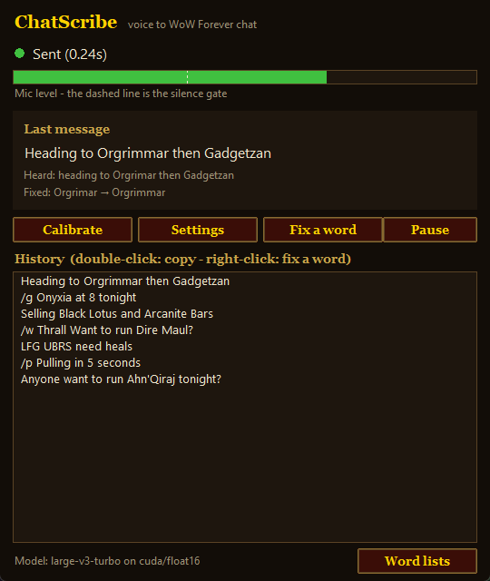

<div align="center">


# ChatScribe: Speech-to-Text for World of Warcraft Chat

**Voice-to-text for WoW. Talk into your mic and it types into chat, with WoW names spelled right.**

Free, open-source push-to-talk dictation for **World of Warcraft: Forever**. It runs 100% offline on your own GPU.

[](../../releases/latest)
[](../../actions/workflows/tests.yml)
[](LICENSE)

[Website](https://notninomo.github.io/ChatScribe/) · [Download](../../releases/latest) · [Features](#features) · [FAQ](#faq) · [How it works](#how-it-works) · [Build from source](#build-from-source)



</div>

---

Hold a key, say *"anyone want to run on kiraj tonight"*, let go. Your WoW chat gets:

```
Anyone want to run Ahn'Qiraj tonight?
```

Looking for a **WoW speech-to-text addon**, a way to **talk to type in World of Warcraft**, or **voice dictation for WoW chat**? A real in-game addon can't do it, because WoW addons can't access your microphone. ChatScribe is a small companion app that does the job instead. You speak, and it types into the WoW chat box for you: party, raid, guild, whispers, trade and emotes.

Normal dictation tools like Windows voice typing mangle Azeroth: you get "on kiraj", "zool gurub" and "Nakekramas". ChatScribe pairs Whisper (OpenAI's open-source speech recognition model) with a word list of over 1,200 WoW terms and a phonetic matcher built for fantasy names. Zones, raids, bosses and slang come out the way players actually write them.

## Who it's for

- **Accessibility.** Players with RSI, carpal tunnel, arthritis or limited hand mobility can chat without typing.
- **Controller and couch players** who can't easily reach a keyboard.
- **Raid leaders and tanks** who need to call things in chat mid-fight without letting go of their keybinds.
- **Anyone who'd rather talk than type**: role-players, guild officers, trade-chat sellers.

## Features

- **Fast and private.** Whisper large-v3-turbo runs on your NVIDIA GPU and turns a line around in about 0.25 s. No account and no cloud: your voice never leaves your PC.
- **Updates itself.** When a new version is out, ChatScribe offers **Update now**. It downloads only what changed (usually about 160 MB), keeps your settings and words, and restarts.
- **Knows WoW.** Its word list covers zones, cities, dungeons, raids, bosses, NPCs, lore characters, factions, classes, spells, items, herbs, consumables, professions and chat slang:
  - `L F G U B R S` → `LFG UBRS`
  - "Safiran" → `Sapphiron`
  - "the barons" → `the Barrens`
- **Leaves normal English alone.** "I fear the alliance will win" stays exactly as you said it.
- **Learns your voice.** A 2-minute calibration has you read WoW lines and remembers how *your* voice gets misheard. You can also right-click any message and choose **Fix a word** to teach it a correction, or **Undo a correction** if it changed something you didn't want changed. **My words** shows everything you've taught or turned off.
- **Real chat punctuation.** It adds question marks on its own and handles spoken punctuation ("question mark", "smiley face" → `:)`). It removes um and uh and writes chat-style numbers ("level sixty" → `level 60`). Messages longer than 255 characters are split automatically.
- **Voice channel commands:**

  | Say | Sends |
  |---|---|
  | "party chat, pulling in five seconds" | `/p Pulling in 5 seconds` |
  | "tell guild Onyxia at eight tonight" | `/g Onyxia at 8 tonight` |
  | "whisper Thrall, want to run Dire Maul" | `/w Thrall Want to run Dire Maul?` |
  | "raid warning, stack on the tank" | `/rw Stack on the tank` |
  | "trade chat, WTS Black Lotus" | `/2 WTS Black Lotus` |
  | "slash dance" | `/dance` |
  | "… scratch that" | *(nothing is sent)* |

  A channel only switches on a deliberate command. "Party is ready" and "in the raid tonight…" stay normal chat.
- **Several push-to-talk keys.** Keyboard keys and mouse side buttons both work, and each key can have its own channel (for example, Mouse 5 → Party, or a key just for **/me emotes**).
- **Fits the game.** A dark, gold-trimmed window in the style of the classic UI, plus an optional click-through "Listening" badge.

## Download

1. Grab `ChatScribe-vX.Y.Z-windows.zip` from [Releases](../../releases/latest) and unzip it anywhere.
2. Run **`ChatScribe.exe`**. The first start downloads the speech model (about 1.6 GB, once).
3. Click **Calibrate** and follow the three short steps.
4. In game, hold **Right Ctrl**, talk, and let go.

**Requirements:**
- Windows 10 or 11.
- An NVIDIA GPU is strongly recommended (GTX 10-series or newer, about 3 GB of VRAM).
- Without one, pick the `small.en` model in Settings. It runs on the CPU and is slower and less accurate.

> If WoW runs **as administrator**, ChatScribe must too. Windows blocks programs from sending keys into elevated windows.

## How it works

```
 hold key ──► mic (pre-roll, noise gate, normalise)
          ──► Whisper large-v3-turbo on CUDA, primed with WoW vocabulary
          ──► voice commands      "party chat ..."  "scratch that"
          ──► spoken punctuation  "question mark" → ?
          ──► WoW lexicon         exact aliases + phonetic sound-alike matching
          ──► chat formatting     questions, casing, numbers, 255-char split
          ──► WoW chat box        Enter, paste, Enter (your clipboard is restored)
```

Each stage is a small module under [`chatscribe/`](chatscribe):

| Module | Does |
|---|---|
| `engine.py` | Whisper via faster-whisper / CTranslate2 (CUDA float16, CPU fallback) |
| `audio.py` | Always-open mic stream with pre-roll, calibrated noise gate, normalisation |
| `lexicon.py` | Loads `lexicon/*.txt`; exact alias, glued-acronym and sound-alike correction |
| `phonetics.py` | Phonetic key tuned for fantasy names ("Ahn'Qiraj" ≈ "on kiraj") |
| `textproc.py` | Channel commands, punctuation, questions, casing, numbers, chat style |
| `typer.py` | WoW focus check, clipboard paste via `SendInput`, clipboard restore |
| `hotkey.py` | Global keyboard / mouse push-to-talk via low-level hooks |
| `calibration.py` | Noise and speech level measurement; learns misheard words |
| `ui.py` | Main window, overlay, settings, calibration wizard |

**Accuracy.** [`tools/benchmark.py`](tools/benchmark.py) has three Windows text-to-speech voices read 18 WoW chat lines and runs each one through the same pipeline as the app:

| | Word accuracy | Exact lines |
|---|---|---|
| Whisper alone | 88.4% | — |
| **ChatScribe** | **99.6%** | **53 / 54** |

Median latency is 0.25 s on an RTX 4080. Real voices after calibration should do at least as well.

## Add your own words

Put guild names, friends, alts, and new Forever zones or bosses into **`lexicon/custom.txt`**, which is created on first run. One entry per line, with the misheard versions after `=`:

```
Ironclad Vanguard = iron clad vanguard
Badbluud = bad blood
```

Names that aren't English words are matched by sound automatically, even if you never list a misheard version. See [`lexicon/README.txt`](lexicon/README.txt) for the full format.

## Build from source

You need Python 3.10 or newer on Windows.

```bat
git clone https://github.com/<you>/ChatScribe
cd ChatScribe
scripts\setup.bat            :: creates .venv and installs everything
scripts\run.bat              :: run from source
```

| Task | Command |
|---|---|
| Run with a log console | `scripts\run-debug.bat` |
| Text pipeline tests | `.venv\Scripts\python -m pytest tests -q` |
| End-to-end benchmark | `.venv\Scripts\python tools\benchmark.py` |
| Build `dist\ChatScribe\ChatScribe.exe` | `scripts\build.bat` (bundles the model, works offline) |
| Small build for a release | `scripts\build.bat --no-model --zip` |

Pushing a `v*` tag builds the release zip with GitHub Actions (see [`.github/workflows`](.github/workflows)).

## Files ChatScribe writes

Everything stays inside its own folder:

```
config.json                 settings (from the Settings window)
data/learned_aliases.json   words learned from calibration and "Fix a word"
data/chatscribe.log         log (rotated at 2 MB)
bundle.json                 version info the updater uses
models/                     the speech model
lexicon/custom.txt          your own words
```

## FAQ

### Is there a speech-to-text addon for World of Warcraft?
Not inside the game. WoW addons run in a sandbox: they can't hear your microphone or receive data from outside WoW. That's why ChatScribe is a small companion app. It listens to your mic, turns your speech into text on your PC, and types it into the WoW chat box the way you would: one key press gives you one chat line. You don't install anything into your AddOns folder.

### Can I talk to type in WoW chat?
Yes, that's exactly what ChatScribe does. Hold your push-to-talk key (Right Ctrl by default, or a mouse side button), speak, and let go. The line is typed into chat and sent. Say "party chat", "tell guild" or "whisper Name" at the start to pick the channel by voice.

### Is it free? Does it need an account or the internet?
It's free and open source (MIT). There's no account, no subscription and no cloud service. Speech recognition runs on your own GPU, so nothing you say ever leaves your PC. The only internet use is the one-time speech model download (about 1.6 GB) and a quick update check against GitHub at startup, which you can turn off in Settings.

### Does it work with WoW Forever?
Yes. ChatScribe is built for **World of Warcraft: Forever**, and its word list covers Forever's Classic-era zones, dungeons, raids, bosses and items. Add new names to `lexicon/custom.txt` as they appear.

### Is it better than Windows voice typing (Win+H) for WoW?
For WoW chat, yes:
- It knows WoW names, and it matches mispronounced ones by sound.
- It understands chat commands and switches channels by voice.
- It formats lines like chat (no stray full stops, `LFG` instead of "L F G").
- It sends with one key, without leaving the game.

### Do I need an NVIDIA graphics card?
It's recommended. With an NVIDIA GPU a line takes about a quarter of a second. Without one, choose the `small.en` model in Settings. It runs on the CPU and is slower and less accurate.

### Is it safe to use with WoW?
ChatScribe only types text into the chat box, the same as pressing keys yourself, and each push-to-talk press produces one chat line. It doesn't read game memory, automate gameplay or modify game files. As with any third-party tool, using it is your own call.

### Nothing shows up in chat
- Make sure WoW is the active window. Otherwise ChatScribe copies the text to your clipboard instead.
- If WoW runs as administrator, run ChatScribe as administrator too.
- Check `data/chatscribe.log`.

### It types into party chat or the wrong channel
Check Settings → Push-to-talk keys. Each key has its own channel. Don't use the same button as your Discord push-to-talk.

## License

[MIT](LICENSE). World of Warcraft names in `lexicon/` are used only so the app can spell them correctly.

ChatScribe is a fan-made tool. It is not affiliated with or endorsed by Blizzard Entertainment. World of Warcraft and Warcraft are trademarks of Blizzard Entertainment, Inc. Using any third-party tool with the game is your own responsibility.
